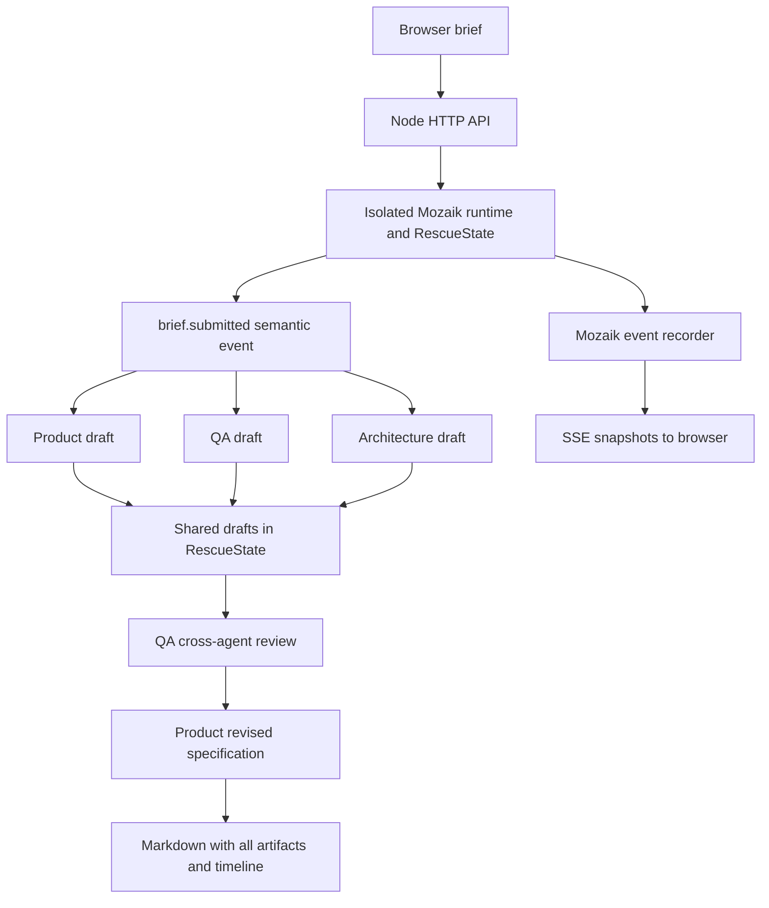

# Spec Rescue

**Turn a fuzzy app idea into a reviewable MVP specification with a concurrent Mozaik agent team.**

Spec Rescue is a Freestyle entry for the NTP Novi Sad AI Hackathon. Product, QA and architecture agents independently analyze the same brief **at the same time**. QA then cross-examines their actual drafts, and Product revises the specification using that review. Original drafts, the critique, the final specification and the Mozaik event timeline remain visible and export together.

The intended user is a solo builder or small team trying to decide what to build next. The useful output is a scoped plan with testable acceptance criteria, explicit unknowns and a record of decisions changed after review. This app produces specifications; it does not generate, deploy or validate the proposed software.

## Inspect real run evidence (no model setup needed)

Start with the [evidence guide](docs/evidence/README.md), read the [book-exchange specification and collaboration transcript](docs/evidence/final-books.md), or inspect the [full run JSON with timestamps and loop IDs](docs/evidence/final-books.json). These are archived outputs from an actual local Qwen run through Mozaik, provided for inspection. They are not canned responses served by the product or a substitute for configuring a model.

Using Node.js, check the saved records without installing dependencies or calling a model:

```sh
node scripts/verify-evidence.mjs
```

The script validates saved timeline and artifact invariants, including the three overlapping initial requests and the review/synthesis order. It does not assess semantic quality or independently establish the records' origin; review the original brief, drafts and final output yourself.

## Run locally

Requirements: **Node.js 22+**, npm, and access to an OpenAI-compatible **Chat Completions** model endpoint. A hosted provider may charge for requests. A local llama.cpp endpoint works without an API key.

```sh
npm ci
```

Copy `.env.example` to `.env` and edit it. On PowerShell:

```powershell
Copy-Item .env.example .env
```

Hosted example:

```dotenv
MODEL_BASE_URL=https://api.openai.com/v1
MODEL_NAME=gpt-5.4-mini
MODEL_API_KEY=your-own-key
MODEL_MAX_OUTPUT_TOKENS=3000
RUN_TIMEOUT_MS=600000
```

Local llama.cpp example (use the model ID returned by your own `/v1/models`):

```dotenv
MODEL_BASE_URL=http://127.0.0.1:8081/v1
MODEL_NAME=home-chat
MODEL_API_KEY=
MODEL_MAX_OUTPUT_TOKENS=3000
RUN_TIMEOUT_MS=600000
```

Then:

```sh
npm start
```

Open **http://127.0.0.1:4317**. Paste a brief, select **Rescue this brief**, watch the three independent drafts overlap, inspect the review and download the result as Markdown. `npm run dev` restarts the server after TypeScript changes. No separate frontend build is required.

`OPENAI_API_KEY`, `OPENAI_BASE_URL` and `MOZAIK_MODEL` are fallback configuration names. `MODEL_*` settings take precedence. Restart the server after editing `.env`. `/api/config` checks configuration, not live provider availability; connection errors appear on the run. The app does not silently replace missing or failing model calls with canned results.

## Three briefs to try

1. **Second-hand books:** “Build a student book exchange for one university. Students post a book, search listings and arrange an in-person exchange. We need an MVP by tomorrow. We have not decided whether to support payments or how to handle personal contact details.”
2. **Appointments:** “Create a small salon booking app. Customers pick a service and time, staff manage availability, and bookings must not overlap. We have two staff members and no budget for SMS. What should the first version include?”
3. **Event registration:** “We need a workshop registration page for 50 seats with a waiting list. Organizers want attendee export and cancellations. We want it live tomorrow; account creation and online payments are undecided.”

## Architecture and real concurrency



- **Mozaik 4.2.0** (`@mozaik-ai/core`) owns the participant registry, event delivery, agent memories and `runLoop` state machines. Every HTTP run gets its own `defineRuntime<RescueState>()` instance.
- Three `createAgent` participants react to `brief.submitted` with separate, non-blocking `runLoop` calls. All three model requests are launched before waiting for any draft. Local model servers may queue GPU execution internally; the application still has three concurrent in-flight agent loops.
- The shared typed `RescueState` holds drafts, the critique, active stages and the public snapshot. The third `draft.ready` event triggers QA's cross-review. QA receives all three actual drafts, including its own initial analysis; it must cite concrete claims and distinguish genuine conflicts from uncertainty.
- `review.ready` triggers the Product agent's final revision. The prompt requires **Decisions & changes after review**, **Assumptions**, and **Open Questions**. QA checks explicitly undecided user choices against the original brief; Product must preserve each as an open question even when the agents recommend a provisional default. Peer agreement is not user approval. Proposed implementation choices are labeled accordingly. One review/revision cycle bounds latency and cost: **five model calls** per successful run.
- A Mozaik observer records real `inference.started`, `inference.completed` and `model.answer` events, with runtime `loopId` and timestamps. `agent.started` and run lifecycle entries are explicitly application events. No generated progress percentages are used.
- The production `InferenceRunner` adapter implements Mozaik's public interface using `fetch` against `/chat/completions`. It maps Mozaik context messages and returns actual `ModelMessageItem` instances. This supports local models, cancellation and sanitized provider errors. Model calls only occur through Mozaik `runLoop`; there is no second agent harness.
- Native browser JavaScript receives snapshots over SSE. Agent output is displayed as text, not executed as HTML. Completed exports include the initial brief, final spec, original drafts, review and complete event timeline.

## Verify it

```sh
npm run typecheck
npm test
```

The automated tests use an explicitly injected **test-only** inference fixture; there is no fixture or simulation mode in the product. The concurrency test holds all draft responses until it observes three active model requests, then checks the five-call lifecycle, unique Mozaik loop IDs and cross-agent prompt dependencies. Other tests cover run isolation, immutable snapshots, sanitized failures, abort on timeout, configuration, input validation, cross-origin rejection, SSE and Markdown export.

To inspect live evidence, start a real run and expand the event timeline. Three `inference.started` entries should precede the first draft's completion. The next request is QA review and the fifth is Product synthesis. Downloads preserve the timeline and artifacts for independent inspection.

## API

| Method | Path | Result |
| --- | --- | --- |
| GET | `/api/config` | Configured model, readiness and missing settings; no keys |
| POST | `/api/runs` | JSON `{ "brief": "..." }`, returns `{ "id": "..." }` |
| GET | `/api/runs/:id` | Full current snapshot |
| GET | `/api/runs/:id/events` | SSE `data:` snapshots, closes on completion/failure |
| GET | `/api/runs/:id/export` | Completed Markdown and collaboration evidence |

## Scope, privacy and limitations

- Default binding is loopback (`HOST=127.0.0.1`); this is a single-user local application without accounts. Do not expose it publicly without authentication, a proxy and appropriate provider usage controls.
- The model provider receives the brief and agent drafts. Avoid confidential input unless your chosen provider is suitable. Credentials stay server-side, `.env` is ignored, and provider error bodies are never returned to the browser.
- Each run times out and aborts its outstanding HTTP requests. Provider-specific billing or already-started GPU work may continue independently.
- At most two runs are active. The most recent 20 runs are retained in process memory only, with no database. Restarting loses history; download completed results you want to keep.
- Output is model-generated advice and must be reviewed. There is no external fact checking, repository inspection or execution of acceptance tests. Contradictions may be missed; uncertain choices should remain explicit.
- Latency depends heavily on the model and hardware. Remote providers may rate-limit three simultaneous requests. An API error fails the run clearly; there is no automatic retry that might multiply charges.
- Qwen-compatible loopback endpoints receive `chat_template_kwargs.enable_thinking=false` to bound local latency. The adapter supports text-only chat completion responses, not tool-calling models or Responses-only endpoints.
- **Optional Mozaik Cloud:** use your own project key or the official pairing flow (`npx @mozaik-ai/cloud-sdk pair`) to enable cloud observability. Without credentials, Mozaik prints “telemetry disabled.” When cloud telemetry is enabled, runtime traces can include prompts and model outputs; only enable it for data you intend to send there.

Built during the hackathon with AI-assisted development. See `docs/` for the submission description and demo guide.
